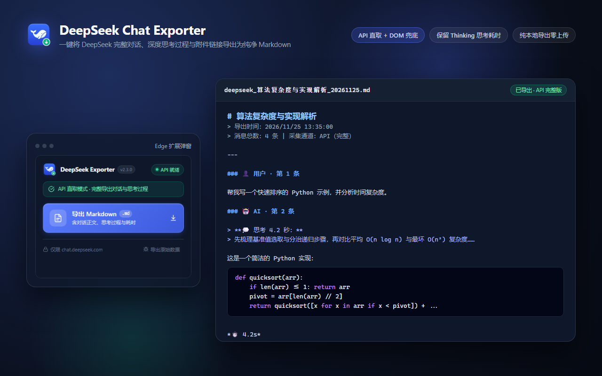
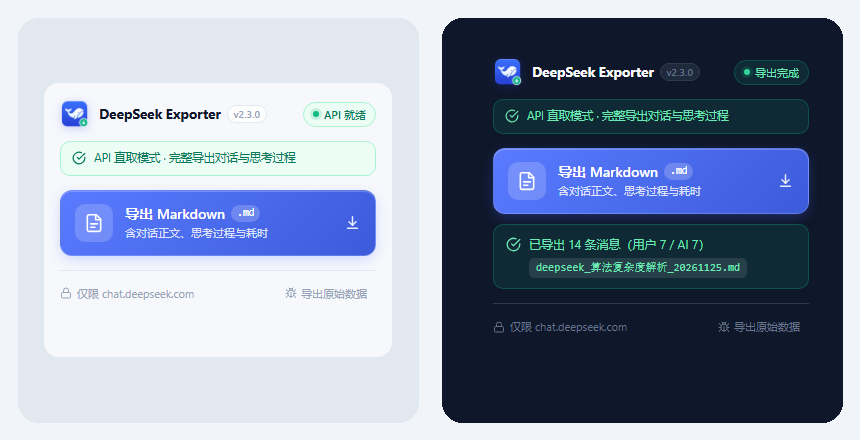
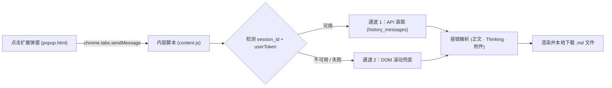

<div align="center">


# DeepSeek Chat Exporter

**一键将 DeepSeek 网页端完整对话（含深度思考过程与附件链接）导出为纯净 Markdown**

[](https://microsoftedge.microsoft.com/addons/detail/gjcnegdbpdngedmopbdnkodhnlplnmmf)
[](./manifest.json)
[](./manifest.json)
[](./PRIVACY.md)
[](./tests/edge-e2e.test.js)

[效果预览](#-效果预览) · [为什么需要它](#-为什么需要它) · [典型用途](#-典型用途) · [安装与使用](#-安装与使用) · [工作原理](#-工作原理) · [隐私与安全](#-隐私与安全)

</div>

---

## ✨ 效果预览

在 `chat.deepseek.com` 任意对话页点击扩展图标，即可导出包含**标题、时间戳、用户提问、AI 深度思考（Thinking）及耗时、代码块与附件链接**的标准 `.md` 文件：

<div align="center">
  
</div>

弹窗界面自动跟随系统 **浅色 / 深色模式** 切换，清晰展示当前采集通道（`API 就绪` / `DOM 模式`）与导出统计结果：

<div align="center">
  
</div>

---

## 🤔 为什么需要它

在 DeepSeek 网页端直接选中复制长对话，通常会遇到几个痛点：

| 痛点 | 网页直接复制 | DeepSeek Chat Exporter |
| --- | --- | --- |
| **长对话虚拟滚动** | 超长对话只渲染可见区域，全选复制容易漏掉前半段历史 | **API 直取优先**，一次性获取整段对话全量消息 |
| **深度思考（R1）过程** | 思考过程折叠隐藏，复制后与正文混杂、丢失耗时信息 | 单独整理为 Markdown 引用块，并保留 **`思考 x.xs`** 耗时 |
| **多轮格式与代码** | 角色归属模糊，代码块和附件容易错乱 | 自动区分 `👤 用户` / `🤖 AI` 轮次，完整保留代码块与图片/附件链接 |
| **网络未登录 / 分享页** | 部分场景难以整页保存 | 无法走 API 时自动切换 **DOM 滚动兜底通道** |

---

## 🎯 典型用途

- **个人知识库沉淀（Obsidian / Notion / 思源笔记 / Logseq）**  
  导出的 `.md` 文件结构干净，天然带有分级标题、分割线与引用块，拖进笔记软件即可建立索引与双链。
- **代码排障与技术方案归档**  
  把与 DeepSeek 讨论架构设计、Bug 定位的完整对话连同推理过程和代码片段一起保存，放入项目文档留档。
- **科研论文研读与写作草稿整理**  
  将文献总结、提示词迭代与多轮追问的结论快速导出，方便在本地编辑器中二次加工。
- **重要对话离线备份**  
  所有对话纯本地落盘保存，不担心页面刷新、链接失效或账号切换导致记录难以回溯。

---

## 🚀 核心特性

- **双通道采集，兼顾完整性与可用性**
  - **API 直取模式（主通道）**：读取本地页面会话标识并请求历史消息接口，1 秒内拉取完整对话，不错过折叠历史。
  - **DOM 滚动兜底（备选通道）**：面对未登录分享页等无法直连 API 的场景时，自动滚动列表并提取可见内容。
- **容错解析器（v2.3.0）**  
  不依赖脆弱的固定消息 `type` 白名单，兼容多种 `fragments` 与字段结构，避免平台前端微调导致用户提问丢失。
- **极简权限与纯本地处理**  
  仅申请最小必要权限（`activeTab` 与 `https://chat.deepseek.com/*`），无后台常驻脚本、无远程代码、不向任何第三方服务器上传数据。
- **内置排查工具**  
  弹窗右下角提供「导出原始数据」，当 DeepSeek 接口结构更新引发解析异常时，可一键导出原始响应与解析预览 JSON 用于快速定位字段变化。

---

## 📦 安装与使用

### 方式一：Microsoft Edge 扩展商店（推荐）

前往扩展商店页面安装：  
👉 **[DeepSeek Chat Exporter - Microsoft Edge Add-ons](https://microsoftedge.microsoft.com/addons/detail/gjcnegdbpdngedmopbdnkodhnlplnmmf)**

> 注：新版 `v2.3.0`（含新版鲸鱼图标、纯 Markdown 极简弹窗与容错解析）当前处于商店审阅阶段，审核通过后将自动推送更新。

### 方式二：本地加载开发版（Edge / Chrome 通用）

1. 克隆或下载本仓库源码：
   ```bash
   git clone https://github.com/limingjing6666/deepseek-chat-exporter.git
   ```
2. 在浏览器地址栏打开扩展管理页：
   - Edge：`edge://extensions`
   - Chrome：`chrome://extensions`
3. 打开右上角 **开发人员模式**。
4. 点击 **加载解压缩的扩展**，选择本仓库根目录即可使用。

### 使用步骤

1. 在浏览器打开 [https://chat.deepseek.com](https://chat.deepseek.com/) 并进入需要备份的对话页面。
2. 点击浏览器右上角工具栏中的 **DeepSeek Chat Exporter** 图标。
3. 确认状态为 **API 就绪**（或 **DOM 模式**）后，点击 **导出 Markdown**。
4. 浏览器将自动下载以 `deepseek_<对话标题>_<时间戳>.md` 命名的文件。

---

## 📄 导出 Markdown 示例

````markdown
# 算法复杂度与实现解析

> 导出时间：2026/11/25 13:35:00
> 消息总数：2 条 | 采集通道：API（完整）

---

### 👤 用户 · 第 1 条

帮我写一个快速排序的 Python 示例，并分析时间复杂度。

---

### 🤖 AI · 第 2 条

> **💭 思考 4.2 秒：**
>
> 先梳理基准值选取与分治递归步骤，再对比平均 O(n log n) 与最坏 O(n²) 复杂度……
>

这是一个简洁的 Python 实现：

```python
def quicksort(arr):
    if len(arr) <= 1:
        return arr
    pivot = arr[len(arr) // 2]
    return quicksort([x for x in arr if x < pivot]) + [x for x in arr if x == pivot] + quicksort([x for x in arr if x > pivot])
```

*⏱️ 4.2s*

---
````

---

## 🔧 工作原理



### 项目结构

```text
├── manifest.json          # MV3 扩展清单（v2.3.0）
├── content.js             # 内容脚本：双通道采集、容错解析与 Markdown 渲染
├── popup.html             # 扩展弹窗界面（浅色 / 深色主题自适应）
├── popup.js               # 弹窗状态检测、消息通信与反馈逻辑
├── icon16.png             # 工具栏图标 (16×16)
├── icon48.png             # 扩展管理图标 (48×48)
├── icon128.png            # 商店与弹窗图标 (128×128)
├── docs/                  # README 展示图
├── tests/
│   └── edge-e2e.test.js   # 基于 Playwright + Microsoft Edge 的真实浏览器 E2E 测试
├── STORE_LISTING.md       # Edge 商店上架说明参考
└── PRIVACY.md             # 隐私政策说明
```

---

## 🧪 测试与开发验证

本项目包含基于 **Playwright + 本机 Microsoft Edge** 的真实 MV3 扩展端到端测试（通过 CDP 加载未打包扩展，以网络拦截模拟页面与接口响应，验证弹窗状态、真实文件下载及浅/深色主题适配）：

```bash
# 运行真实 Microsoft Edge E2E 测试（无头模式）
node tests/edge-e2e.test.js

# 如需可视化观察 Edge 窗口执行过程
HEADLESS=false node tests/edge-e2e.test.js
```

---

## 🔒 隐私与安全

- 本扩展**不收集、不存储、不出售、不向任何外部服务器发送**用户的任何聊天记录、账号信息或访问令牌。
- 更多细节请参阅 [PRIVACY.md](./PRIVACY.md)。
- **免责声明**：本项目为第三方开源效率工具，与 DeepSeek 官方无从属或合作关系；请勿将其用于违反目标网站服务条款的用途。
